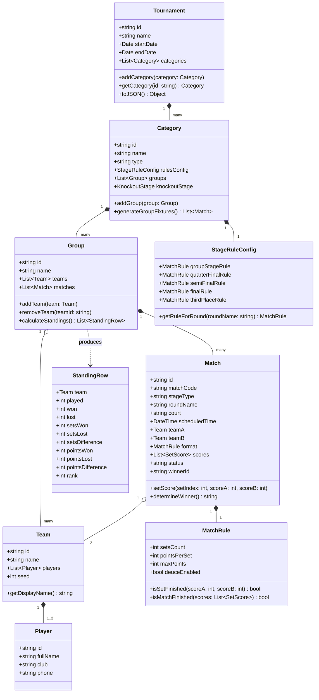
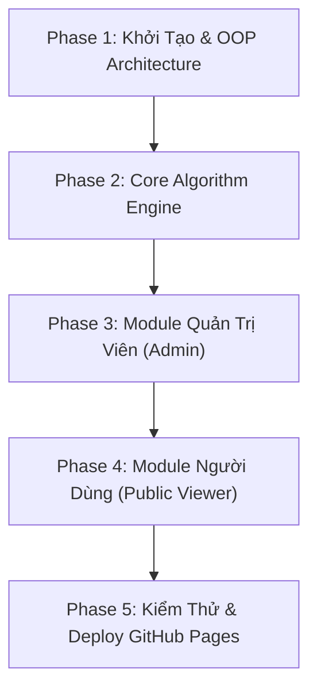

# KẾ HOẠCH TRIỂN KHAI WEB APP QUẢN LÝ GIẢI CẦU LÔNG (BADMINTON TOURNAMENT MANAGER)

> **Mục tiêu**: Xây dựng ứng dụng web quản lý giải cầu lông hoạt động hoàn toàn trên **GitHub Pages**, sử dụng **Firebase Realtime Database** để đồng bộ dữ liệu thời gian thực.
> **Kiến trúc**: Thiết kế theo tư duy **Lập trình Hướng đối tượng (OOP)**, module hóa cao, cấu hình linh hoạt không hard-code.

---

## MỤC LỤC
1. [Kiến Trúc Tổng Thể & Mô Hình Hướng Đối Tượng (OOP)](#1-kiến-trúc-tổng-thể--mô-hình-hướng-đối-tượng-oop)
2. [Thiết Kế Cấu Trúc Dữ Liệu (Firebase Realtime Database)](#2-thiết-kế-cấu-trúc-dữ-liệu-firebase-realtime-database)
3. [Lộ Trình Triển Khai Chi Tiết Theo Từng Phase](#3-lộ-trình-triển-khai-chi-tiết-theo-từng-phase)
   - [Phase 1: Khởi Tạo Dự Án & Thiết Kế Kiến Trúc OOP](#phase-1-khởi-tạo-dự-án--thiết-kế-kiến-trúc-oop-ngày-1)
   - [Phase 2: Core Algorithm Engine (Xếp Trận, BXH & Thể Thức)](#phase-2-core-algorithm-engine-ngày-2)
   - [Phase 3: Module Dành Cho Quản Trị Viên (Admin Portal)](#phase-3-module-dành-cho-quản-trị-viên-admin-portal-ngày-3-5)
   - [Phase 4: Module Dành Cho Khán Giả & VĐV (Public Viewer)](#phase-4-module-dành-cho-khán-giả--vđv-public-viewer-ngày-6-7)
   - [Phase 5: Kiểm Thử, Tối Ưu & Triển Khai GitHub Pages](#phase-5-kiểm-thử-tối-ưu--triển-khai-github-pages-ngày-8)
4. [Bảng Tiến Độ & Mốc Hoàn Thành (Milestones)](#4-bảng-tiến-độ--mốc-hoàn-thành-milestones)

---

## 1. KIẾN TRÚC TỔNG THỂ & MÔ HÌNH HƯỚNG ĐỐI TƯỢNG (OOP)

Ứng dụng tuân thủ nguyên tắc OOP (Tính đóng gói, Tính trừu tượng, Single Responsibility Principle). Tất cả các thực thể giải đấu đều được biểu diễn bằng các Class độc lập, không hard-code bất kỳ logic hoặc giá trị cố định nào.

### 1.1. Sơ Đồ Lớp (Class Diagram)



---

## 2. THIẾT KẾ CẤU TRÚC DỮ LIỆU (FIREBASE REALTIME DATABASE)

Dữ liệu được tổ chức dạng JSON cây phẳng (denormalized), tối ưu cho truy vấn realtime và tránh lồng ghép quá sâu:

```json
{
  "tournaments": {
    "tournament_2026_spring": {
      "id": "tournament_2026_spring",
      "name": "Giải Cầu Lông Mở Rộng 2026",
      "settings": {
        "courts": ["Sân 1", "Sân 2", "Sân 3", "Sân 4"],
        "adminPinHash": "8c6976e5b5410415bde908bd4dee15dfb167a9c873fc4bb8a81f6f2ab448a918"
      },
      "categories": {
        "cat_men_doubles": {
          "id": "cat_men_doubles",
          "name": "Đôi nam",
          "rulesConfig": {
            "groupStage": { "setsCount": 1, "pointsPerSet": 31, "maxPoints": 31, "deuceEnabled": false },
            "quarterFinals": { "setsCount": 3, "pointsPerSet": 21, "maxPoints": 30, "deuceEnabled": true },
            "semiFinals": { "setsCount": 3, "pointsPerSet": 21, "maxPoints": 30, "deuceEnabled": true },
            "finals": { "setsCount": 3, "pointsPerSet": 21, "maxPoints": 30, "deuceEnabled": true },
            "thirdPlace": { "setsCount": 3, "pointsPerSet": 21, "maxPoints": 30, "deuceEnabled": true }
          },
          "groups": {
            "group_a": {
              "id": "group_a",
              "name": "Bảng A",
              "teamIds": ["team_01", "team_02", "team_03"]
            },
            "group_b": {
              "id": "group_b",
              "name": "Bảng B",
              "teamIds": ["team_04", "team_05", "team_06"]
            }
          },
          "knockoutStages": [
            {
              "roundName": "Bán kết",
              "matchIds": ["match_sf_01", "match_sf_02"]
            },
            {
              "roundName": "Chung kết",
              "matchIds": ["match_final_01"]
            },
            {
              "roundName": "Tranh hạng 3-4",
              "matchIds": ["match_third_01"]
            }
          ]
        }
      },
      "teams": {
        "team_01": {
          "id": "team_01",
          "name": "Nguyễn Văn A / Trần Văn B",
          "players": [
            { "id": "p1", "fullName": "Nguyễn Văn A", "club": "CLB Cầu Lông Trẻ" },
            { "id": "p2", "fullName": "Trần Văn B", "club": "CLB Cầu Lông Trẻ" }
          ]
        }
      },
      "matches": {
        "match_001": {
          "id": "match_001",
          "matchCode": "DN-A-01",
          "categoryId": "cat_men_doubles",
          "stageType": "GROUP",
          "groupName": "Bảng A",
          "court": "Sân 1",
          "scheduledTime": "2026-11-02T08:30:00",
          "teamAId": "team_01",
          "teamBId": "team_02",
          "rule": {
            "setsCount": 1,
            "pointsPerSet": 31,
            "maxPoints": 31,
            "deuceEnabled": false
          },
          "scores": [
            { "teamA": 31, "teamB": 28 }
          ],
          "status": "FINISHED",
          "winnerId": "team_01"
        }
      }
    }
  }
}
```

---

## 3. LỘ TRÌNH TRIỂN KHAI CHI TIẾT THEO TỪNG PHASE



---

### Phase 1: Khởi Tạo Dự Án & Thiết Kế Kiến Trúc OOP (Ngày 1)
- **1.1. Khởi tạo Project Web tĩnh**:
  - React + TypeScript + Vite.
  - Cấu hình Tailwind CSS, Lucide Icons, Headless UI / Radix.
- **1.2. Xây dựng Tầng Domain Model (OOP)**:
  - Viết các class độc lập:
    - `Tournament.ts`
    - `Category.ts`
    - `Group.ts`
    - `Team.ts`
    - `Player.ts`
    - `Match.ts`
    - `MatchRule.ts`
    - `StageRuleConfig.ts`
  - Đảm bảo tuân thủ tính đóng gói, có hàm validate và chuyển đổi JSON hai chiều (`toJSON()`, `fromJSON()`).
- **1.3. Cấu hình Firebase Realtime Database**:
  - Tạo file cấu hình client `src/services/firebase.ts`.
  - Tạo lớp `TournamentRepository` và `MatchRepository` theo mô hình Repository Pattern giúp tách biệt hoàn toàn tầng giao diện với cơ sở dữ liệu.

---

### Phase 2: Core Algorithm Engine (Ngày 2)
- **2.1. Lớp Thuật Toán Xếp Lịch Tự Động (`RoundRobinScheduler`)**:
  - Thuật toán xoay vòng tròn (Berger Tables / Polygon method) giúp tất cả các cặp trong bảng gặp nhau đúng 1 lần.
  - Cơ chế **Shuffle/Random** thứ tự các lượt đấu để tránh thiên vị.
  - Tự động gán mã trận (VD: `[Mã ND]-[Bảng]-[Số TT]`).
  - Tự động rải đều sân thi đấu (Sân 1, Sân 2...) và giãn cách khung giờ.
- **2.2. Lớp Tính Bảng Xếp Hạng Vòng Bảng (`StandingsCalculator`)**:
  - Tính toán tự động theo tiêu chuẩn Liên đoàn Cầu lông Thế giới (BWF):
    1. Số trận thắng
    2. Hiệu số Set (Set thắng - Set thua)
    3. Hiệu số Điểm (Điểm ghi được - Điểm mất)
    4. Đối đầu trực tiếp (Head-to-head)
- **2.3. Lớp Xử Lý Luật Thi Đấu (`RuleEngine`)**:
  - Linh hoạt xử lý điều kiện kết thúc trận đấu:
    - Đánh 1 set: Chạm 31 điểm (hoặc chạm 21/15 điểm tùy cấu hình).
    - Đánh 3 set: Thắng 2 set là kết thúc trận.
    - Xử lý luật Deuce (cách 2 điểm, trần tối đa 30 điểm).

---

### Phase 3: Module Dành Cho Quản Trị Viên (Admin Portal) (Ngày 3 - 5)
- **3.0. Cơ Chế Xác Thực Bằng Mã PIN / Secret Key**:
  - Xác thực nhanh chóng, tiện lợi bằng **Mã PIN / Secret Key** (không cần đăng ký Email/Password phức tạp).
  - Quản trị viên chỉ cần nhập mã PIN (ví dụ: mã PIN 6 số hoặc chuỗi bí mật do Ban tổ chức thiết lập).
  - Kiểm tra tính hợp lệ bằng mã băm SHA-256 (hoặc Secret Key so khớp an toàn). Khi xác thực thành công, hệ thống lưu token/session vào `SessionStorage`/`LocalStorage`.
  - Có chức năng đổi mã PIN mới ngay trong mục Cài đặt của Admin.
  - Phân quyền rõ ràng: Người xem bình thường chỉ có quyền Đọc (Read-only); chỉ người nhập đúng mã PIN mới kích hoạt các tính năng Quản trị (Thêm/Sửa/Xóa, Bốc thăm, Nhập điểm).
- **3.1. Quản lý Nội dung, Bảng đấu & Đội thi đấu**:
  - Tạo danh sách nội dung: Đôi nam, Đôi nữ, Đôi nam nữ (hoặc thêm Đơn nam/Đơn nữ tùy thích).
  - Thêm, sửa, xóa Bảng trong nội dung (Bảng A, B, C...).
  - Thêm, sửa, xóa thành viên, cập nhật hạt giống của từng đội.
- **3.2. Trang Xếp Lịch Đấu & Tùy Biến Trực Quan**:
  - Nút bấm **"Xếp trận ngẫu nhiên (Random)"**: Nhấn 1 chạm là tự động sinh toàn bộ danh sách trận cho các bảng.
  - Cho phép quản trị viên **sửa thủ công**: đổi đội A/đội B, đổi sân, đổi giờ thi đấu, xóa hoặc thêm trận bổ sung.
- **3.3. Cấu hình Thể Thức Linh Hoạt Theo Vòng**:
  - Cho phép cấu hình riêng biệt: Vòng bảng đánh 1 set hay 3 set; Tứ kết, Bán kết, Chung kết, Tranh 3-4 đánh 1 set hay 3 set.
- **3.4. Bàn Nhập Điểm Trực Tiếp (Live Score Entry)**:
  - Form nhập điểm trực quan, giao diện nút bấm tăng/giảm điểm hoặc nhập số nhanh.
  - Tự động xác định đội thắng, cập nhật trạng thái trận đấu (`FINISHED`) và đồng bộ realtime lên Firebase.
- **3.5. Bốc Thăm & Nhập Nhánh Đấu Knockout**:
  - Quản trị viên nhập/chọn thủ công các đội xuất sắc từ vòng bảng (Nhất A, Nhì B, Nhất B, Nhì A...) vào các cặp đấu Bán kết / Chung kết / Tranh 3-4.

---

### Phase 4: Module Dành Cho Khán Giả & VĐV (Public Viewer) (Ngày 6 - 7)
- **4.1. Bộ Lọc & Tìm Kiếm Thông Minh (Instant Search)**:
  - Thanh tìm kiếm thời gian thực: gõ tên VĐV, tên đội, tên bảng là lọc ngay danh sách trận và kết quả.
- **4.2. Bảng Xếp Hạng Vòng Bảng Trực Tuyến**:
  - Tự động hiển thị BXH cập nhật ngay tức thì theo thời gian thực (khi Admin nhập điểm xong là bảng BXH nhảy thứ hạng ngay lập tức).
- **4.3. Lịch Thi Đấu & Tỉ Số Trực Tiếp**:
  - Xem danh sách trận theo Sân đấu hoặc theo Khung giờ.
  - Phân loại trực quan: *Chưa đấu*, *Đang đấu*, *Đã kết thúc*.
- **4.4. Cây Nhánh Đấu Trực Quan (Knockout Bracket Tree)**:
  - Giao diện đồ họa hiển thị nhánh đấu vòng tròn -> Tứ kết -> Bán kết -> Chung kết & Tranh hạng 3-4.

---

### Phase 5: Kiểm Thử, Tối Ưu & Triển Khai GitHub Pages (Ngày 8)
- **5.1. Thiết lập GitHub Pages & GitHub Actions**:
  - Cấu hình file workflow `.github/workflows/deploy.yml` tự động build và publish lên nhánh `gh-pages`.
  - Cấu hình Router sử dụng `HashRouter` để hoạt động trơn tru không lỗi 404 trên hosting tĩnh.
- **5.2. Tối ưu Trải Nghiệm Di Động (Mobile-First)**:
  - Tối ưu giao diện xem trên smartphone cho các trọng tài và khán giả trên sân đấu.
- **5.3. Kiểm thử Tải & Đồng Bộ Realtime**:
  - Kiểm tra khả năng mở đồng thời nhiều thiết bị, bảo đảm độ trễ cập nhật điểm số < 1 giây.

---

## 4. BẢNG TIẾN ĐỘ & MỐC HOÀN THÀNH (MILESTONES)

| Phase | Nội Dung Trọng Tâm | Thời Gian | Kết Quả Đầu Ra |
|:---:|---|:---:|---|
| **Phase 1** | Khởi tạo dự án, thiết kế OOP Class & Firebase SDK | 1 ngày | Bộ khung mã nguồn sạch, các Entity OOP và kết nối DB |
| **Phase 2** | Lập trình Engine Xếp lịch, BXH BWF & Thể thức | 1 ngày | Thuật toán bốc thăm ngẫu nhiên, tự động tính điểm chuẩn |
| **Phase 3** | Xây dựng Admin Portal & Bàn nhập tỉ số | 3 ngày | Quản lý đội/bảng, bốc thăm 1 click, nhập tỉ số trực tiếp |
| **Phase 4** | Xây dựng Public Viewer, Tìm kiếm & Nhánh Knockout | 2 ngày | Màn hình xem tỉ số realtime, tra cứu VĐV, sơ đồ nhánh đấu |
| **Phase 5** | Responsive di động, CI/CD tự động lên GitHub Pages | 1 ngày | Trang web trực tuyến hoạt động hoàn chỉnh trên GitHub Pages |

---
*Tài liệu được khởi tạo và lưu trữ tại thư mục gốc dự án.*
